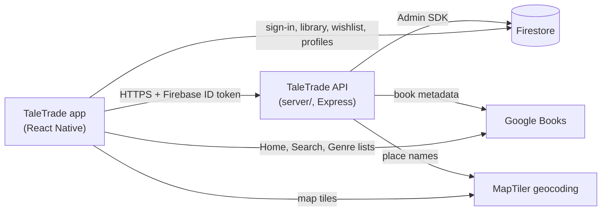
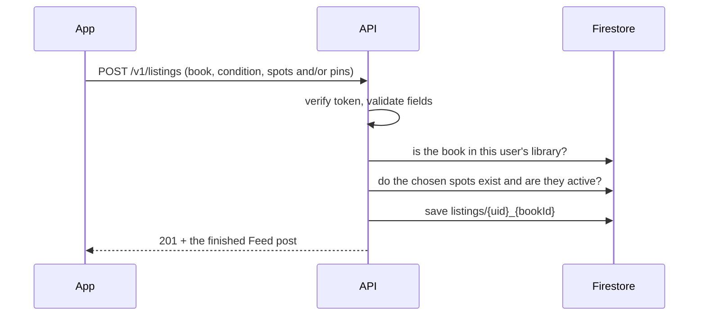

# How TaleTrade's own API works

TaleTrade has its **own REST API** in [`server/`](../server). It is a Node.js + Express program that the
mobile app talks to for book details, meetup locations, availability and the community Feed.

This page explains how it works. For the exact parameters and error codes of each endpoint, see
[`server/README.md`](../server/README.md).

## The big picture



**What makes it "our own":** the endpoints, the data they return, the business rules and the `listings`
data are designed and enforced by TaleTrade. Google Books and MapTiler are only upstream data sources
behind some endpoints; their keys stay on the server and their answers are converted into TaleTrade's
own shapes.

**What does not go through our API yet** (shown above): signing in, My Books, wishlist and profile
reads and writes go straight to Firebase; the Home, Search and Genre book lists call Google Books from
the app; map tiles come from MapTiler.

## What happens on every request

1. The app gets the signed-in user's **Firebase ID token** (`src/services/apiClient.ts`).
2. It sends `Authorization: Bearer <token>` to a `/v1/...` URL (12 s timeout).
3. The server applies a **rate limit**: 1200 requests per minute per IP address, then, once the user
   is known, 120 per user.
4. It **verifies the token** with Firebase Admin (`auth.js`). No valid token means `401`.
5. It **validates the input** (`validation.js`); request bodies are limited to 10 KB.
6. `service.js` applies the business rules and reads or writes data through a **store**.
7. It answers with JSON. Errors always look like `{ "error": { "code": "...", "message": "..." } }`.

Only `GET /health` works without a token.

## Layers in the code

| File | Responsibility |
|------|----------------|
| `src/index.js` | Starts the server and plugs in Firestore, Google Books, MapTiler and token verification |
| `src/app.js` | Routes (the URL list) and error handling |
| `src/auth.js`, `src/rateLimit.js`, `src/validation.js` | Security and input checks |
| `src/service.js` | Business logic: feed, listings, spots, books, availability |
| `src/store/firestoreStore.js` | All Firestore queries |
| `src/store/memoryStore.js` | Same interface kept in memory, used by tests and demo mode |
| `src/bookProvider.js` | Google Books → TaleTrade `Book`, with a 10-minute cache |
| `src/placeProvider.js` | Coordinates → place name |
| `src/geo.js` | Distance calculation |

Because the service receives the store and providers as parameters, tests run the real API with fake
data and no network.

## What the API offers

| Endpoint | Used by the app for | Data it combines |
|----------|--------------------|------------------|
| `GET /v1/books/:id` | Book descriptions | Google Books (cached) + owner and listing counts; falls back to our stored title/author/cover |
| `GET /v1/availability` | "N nearby" badges, Book Detail owners and map | Every library + listings + profiles + meetup spots |
| `GET /v1/spots`, `/v1/spots/:id` | Meetup spot picker, map | Curated spots + listing counts + distance |
| `GET /v1/places/reverse` | Naming a pin dropped on the map | MapTiler geocoding |
| `GET /v1/feed` | Feed → Community | Listings + owners + spots, with filters and paging |
| `GET /v1/me/listings`, `/v1/me/books` | My listings, "List a book" | The user's listings and library |
| `GET /v1/users/:id/listings` | A reader's profile | That reader's visible listings |
| `POST`, `PATCH`, `DELETE /v1/listings` | Posting, editing, removing | Writes the `listings` collection |
| `DELETE /v1/me/listings` | Delete account | Removes all of the user's listings |

## Three examples

### Listing a book



Rules enforced on the server: the book must be yours, one listing per book, 1–3 meetup places, only the
owner may change or delete it.

### Who owns this book, and who is nearby

Google Books gives every **edition** a different id, so matching by id alone showed different owners for
the same book. `GET /v1/availability` groups books by **title + first author** and returns, for each
owner, every place they can meet: their preferred spots plus the spots and pins of their listings.

The app then decides what is "nearby" (your preferred spots, or within 10 km if location access is
already allowed). This is done on the phone, so **your position is never sent for this**. Search badges
and Book Detail use the same result, so they always agree.

### Naming a dropped pin

The app first reads the label printed on the map under the tap. If there is none, it calls
`GET /v1/places/reverse?lat&lng`; the server asks MapTiler for a point of interest within 75 m, and
otherwise returns the street and area.

## Data and security

- `listings/{ownerUid}_{bookId}` is written **only by the API**. The app has no Firestore rule allowing
  access to it, and the Admin SDK used by the server bypasses rules.
- The server needs a **service-account key** (`GOOGLE_APPLICATION_CREDENTIALS`). Keep it outside the
  repository and never commit it.
- A listing disappears automatically if its book is no longer in the owner's library.
- Any signed-in user can see readers' usernames, photos, meetup places and listings, which is what the
  Feed and Book Detail display.

## Running it

```powershell
cd server
npm install
$env:GOOGLE_APPLICATION_CREDENTIALS = 'C:\path\to\serviceAccount.json'
$env:GOOGLE_BOOKS_API_KEY = 'your_key'
$env:MAPTILER_API_KEY = 'your_key'
npm start
```

Then set `TALETRADE_API_URL` in the app's `.env` (`http://10.0.2.2:3000` on an emulator;
`http://localhost:3000` on a phone after `adb reverse tcp:3000 tcp:3000`). `npm run demo` starts it with
in-memory sample data. Tests: `npm test` in the repository root.

## Current limits

- `GET /v1/availability` reads **every library** on each call. Fine for a class-sized project; for many
  users it should be precomputed or paged.
- The rate limiter and caches live in memory, so they reset on restart and are per server instance.
- Release builds block plain `http`, so a deployed API needs an `https` address.
- Moving the app's remaining Google Books calls behind the API would remove the book key from the app.
